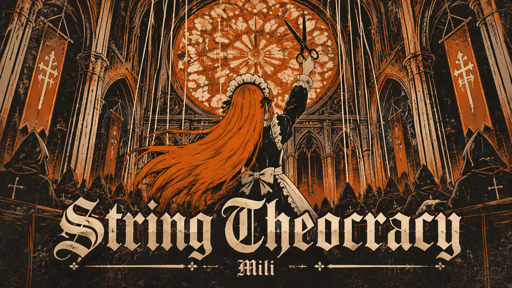

# String Theocracy MV

Mili《String Theocracy》的非商业同人动态 MV 工程。画面是橙 / 炭黑 / 纸色三色木刻版画风格，整支片子由浏览器 Canvas 逐帧绘制，再用 FFmpeg 编码，成片为 3840×2160、60fps、2 分 54 秒。



## 内容

| 目录 | 说明 |
|---|---|
| `mv/full/` | 渲染引擎与 A–M 共 13 段场景代码（Canvas 2D，逻辑坐标 1920×1080） |
| `art/full/` | 全片使用的插画素材（AI 生成，按段落分目录） |
| `art/motion/` | 动效用的分色墨版素材 |
| `music/beatgrid.json` | 由音频分析得到的节拍与镜头时间表 |
| `tools/render.mjs` | 渲染脚本：分段、静帧、断点续渲、拼接混音 |
| `tools/` 其他 | 生图批处理、素材处理与检查脚本 |
| `STORYBOARD.md` | 分镜（88 镜） |
| `docs/dev-notes/` | 制作过程笔记 |
| `cover/` | 封面（16:9 与 4:3） |

## 自行渲染

需要 Node.js 22+、FFmpeg、Edge / Chrome / Chromium。构建细节见 [README_BUILD.md](README_BUILD.md)。

```sh
# 4K 60fps 全片（默认 --scale 2；--scale 1 为 1080p）
node tools/render.mjs --full --fps 60 --scale 2 --out out/full_4k60.mp4
```

**音频和歌词不在仓库中。** 请自行获取正版音频，放到 `music/String Theocracy.mp3`，并准备同名 `.lrc` 歌词文件 `music/String Theocracy.lrc`。时间轴以原曲为准，换音源需确认起始偏移一致。

字体：画面使用 Old English Text MT 与 Consolas（不可再分发）。没有时可安装 UnifrakturMaguntia 与 JetBrains Mono 等开源字体代替，字宽会略有差异。

## 版权与声明

- 原曲 *String Theocracy*（专辑 *To Kill a Living Book -For Library of Ruina-*）的版权属于 Mili 及相关权利人。本项目与原作者、Project Moon 均无关联，仅为粉丝二次创作，不用于商业用途。
- 代码：[MIT](LICENSE)。
- 插画与封面（`art/`、`cover/`）：AI 生成，按 [CC BY-NC 4.0](https://creativecommons.org/licenses/by-nc/4.0/) 提供，禁止商用。
